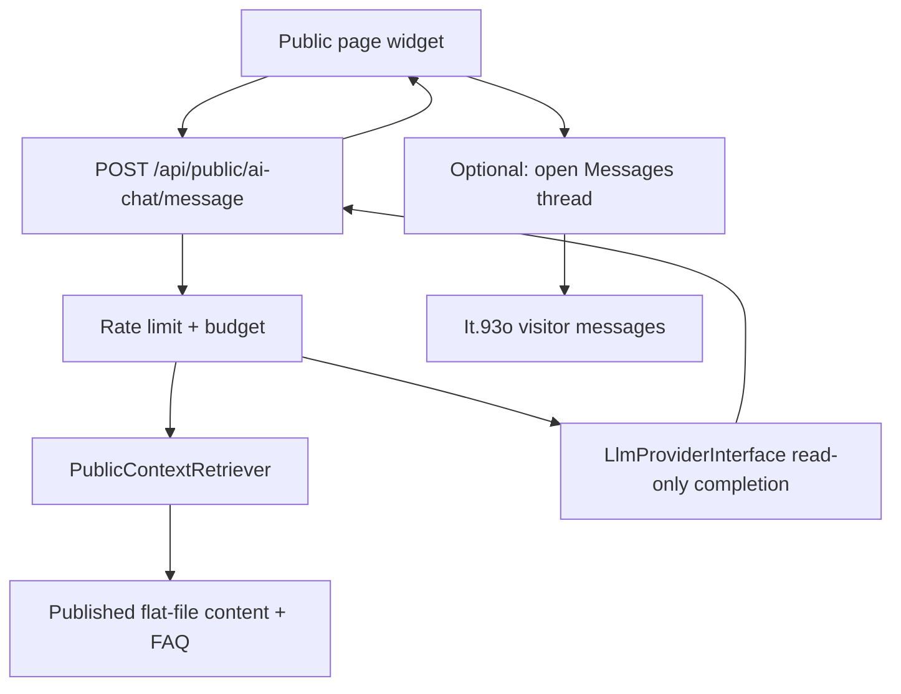

# Iteration 103 — AI assistant expansion (admin polish + public chat widget)

> **Status:** ⏳ planned  
> **Priority:** 🔵 (admin polish **103a**) · 🟡 P2 (public widget **103b** — optional product slice)  
> **Depends on:** [It.75](ITERATION_75.md) (shipped `beta.88`), [It.93o](ITERATION_93.md) (staff/desk/messages), [It.67](ITERATION_67.md) (CSP/sandbox), [It.29](ITERATION_29.md) (queue)  
> **Commercial benchmark (non-integration):** [Elfsight AI Chatbot](https://elfsight.com/ai-chatbot-widget/) — embeddable site assistant with branding, FAQ-style answers, and lead capture; Paginium should offer a **first-party**, self-hosted equivalent tied to flat-file content and existing Messages/desk flows.

## Goal

Close the gap between **It.75 MVP** (“Suggest SEO” in the editor) and what operators expect from a modern AI stack: usable metadata proposals, optional **taxonomy** suggestions, and—when explicitly enabled—a **public** chat surface that answers from **published** content only, with rate limits and human escalation—not an admin tool loop on the open web.

Two tracks share provider settings and security baseline but **must not** share tool registries:

| Track | Audience | Writes content? | LLM tools |
|-------|----------|---------------|-----------|
| **103a — Admin assistant polish** | Signed-in editors | Proposals + Apply only | Existing allow-list + new schema-bound tools |
| **103b — Public AI chat widget** | Anonymous/authenticated visitors | **Never** (read-only answers) | **No** admin tools; optional retrieval over public corpus |

---

## Problems observed (2026-10 homelab)

| Area | Symptom | Gap |
|------|---------|-----|
| SEO Apply | Keywords shown in proposal but not saved | `AgentApplyService` applies title/description only; `keywords` not mapped to `seo.tags` |
| SEO quality | Generic “Article SEO Title” on local 7B | Needs cloud model or stronger prompt/context (partially addressed on `main`: article snapshot + OpenAI message format) |
| Scope | Users expect **article tags/categories** | It.75 table listed “suggest tags/categories”; not implemented as tools |
| Product mix-up | Translation vs agent feel like duplicate effort | Different pipelines—document UX; agent remains optional |
| Public site | Desire for Elfsight-style chat | Out of scope for It.75; requires separate product slice |

---

## 103a — Admin assistant polish (editor)

### Planned scope

1. **Apply mapping**
   - Map `seo.suggest_meta` `keywords` → locale `seo.tags` (comma-separated UI contract).
   - Optional: split/limit count server-side; reject empty-only proposals.

2. **New allow-listed tools** (proposals only, same Apply/OCC pattern)
   - `content.suggest_tags` — suggest tags aligned with existing tag facet / slug rules.
   - `content.suggest_categories` — bound to blog/category model (read-only context + proposal).
   - `newsletter.suggest_snippet` — subject + preheader/snippet proposal (no send).

3. **Editor UX**
   - Show proposal diff for SEO **and** tags/categories when present.
   - Surface provider error codes (inference vs management API key, timeout) in admin-friendly copy.
   - Optional: “metadata only” preset (SEO + tags, no body tools).

4. **Provider ops**
   - Document OpenRouter **inference** keys vs **management** keys in [AGENT_OPERATIONS.md](runbooks/AGENT_OPERATIONS.md).
   - Recommended models table (e.g. DeepSeek Flash, `openai/gpt-4o-mini`) — operator-maintained, not vendor SLA.

5. **Tests**
   - Apply writes `seo.tags` from keywords.
   - New tools schema-rejected on injection/extra keys.
   - PHPUnit + one Vitest panel flow.

### Out of scope (103a)

- Autonomous publish, new provider drivers beyond `openai_compatible` / Ollama adapter.
- Fine-tuning on customer data.

---

## 103b — Public AI chat widget (Elfsight-class, first-party)

### Intent

A **configurable chat bubble** on the public site (React island or `[widget type="ai-chat"]`) that:

- answers questions using **retrieval** over **published** pages/articles (and optional operator-uploaded FAQ flat-files),
- shows **branding** (title, avatar, colors) from settings,
- respects **locale** (visitor + site default),
- **rate-limits** and **budgets** per IP/session,
- offers **human handoff** to existing [It.93o](ITERATION_93.md) visitor Messages / desk when staff is available or when the model abstains,
- never exposes admin APIs, secrets, drafts, or `/api/admin/*`.

Reference feature set (benchmark only): [Elfsight AI Chatbot widget](https://elfsight.com/ai-chatbot-widget/) — train on site content, customize widget, collect leads, multilingual UI. Paginium implements equivalent capabilities **without** third-party script embeds or off-site training.

### Architecture (high level)



### Settings (sketch)

```yaml
agentPublicChat:
  enabled: false
  widgetTitle: ""
  welcomeMessage: ""
  provider: shared_with_agent  # or separate override
  model: ""
  dailyMessageLimit: 0
  maxMessagesPerSession: 20
  allowHandoffToDesk: true
  retrievalLocales: [sk, en]
  leadCapture: none  # none | optional_email | required_email
```

### Security (mandatory)

- **Separate** routes under `/api/public/ai-chat/*` — no admin tool registry, no `Apply`.
- **OutboundUrlGuard** on provider URL; CSP: widget script from `'self'` only (no external Elfsight CDN).
- **LogSanitizer** on visitor messages; no prompt/completion in default audit (metadata only).
- **Fail-closed** when disabled: widget not rendered, API returns 503.
- Retrieval: **published** locale status only; path allow-list; max chunk size; no `data/` or draft paths.
- Optional captcha / honeypot when lead capture enabled (align with contact form guards).

### Phasing

| Phase | Deliverable |
|-------|-------------|
| **103b-1** | Settings schema + disabled-by-default; static FAQ mode (no LLM) to validate widget UX |
| **103b-2** | Retrieval + LLM answers; rate limits; SK/EN strings |
| **103b-3** | Desk handoff + lead capture hooks; admin transcript search (metadata) |

### Out of scope (103b)

- Replacing staff team-chat ([It.93o](ITERATION_93.md)).
- Arbitrary URL fetch / browsing tools.
- Storing full chat logs in git-tracked flat files without retention policy (use derived store + TTL).

---

## Relationship to other iterations

| Iteration | Relationship |
|-----------|--------------|
| [It.102](ITERATION_102.md) | Translation polish — parallel; disable either feature for zero outbound |
| [It.75](ITERATION_75.md) | Foundation; It.103 extends, does not rewrite |
| [It.74](ITERATION_74.md) | Public chat may later allow scoped API keys for headless embed partners — not MVP |
| [It.67](ITERATION_67.md) | Widget HTML/CSP and sandbox policy |

---

## Definition of Done

**103a**

- [ ] `keywords` Apply → `seo.tags` with tests.
- [ ] At least one of: `content.suggest_tags` or `content.suggest_categories` shipped with Apply.
- [ ] AGENT_OPERATIONS updated (keys, models, troubleshooting).
- [ ] CHANGELOG + backlog status on ship.

**103b**

- [ ] Public widget behind `agentPublicChat.enabled`, default off.
- [ ] Retrieval restricted to published content; security review checklist.
- [ ] Rate limit + budget documented for operators.
- [ ] Optional handoff to Messages documented in admin guide.

## Related

[AGENT_OPERATIONS.md](runbooks/AGENT_OPERATIONS.md) · [ITERATION_75.md](ITERATION_75.md) · [ITERATION_102.md](ITERATION_102.md) · [ADMIN_GUIDE.md](user/ADMIN_GUIDE.md) · [SECURITY.md](developer/SECURITY.md)
